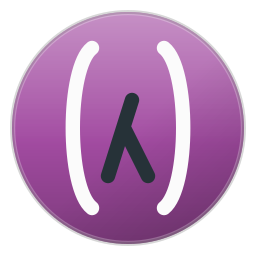
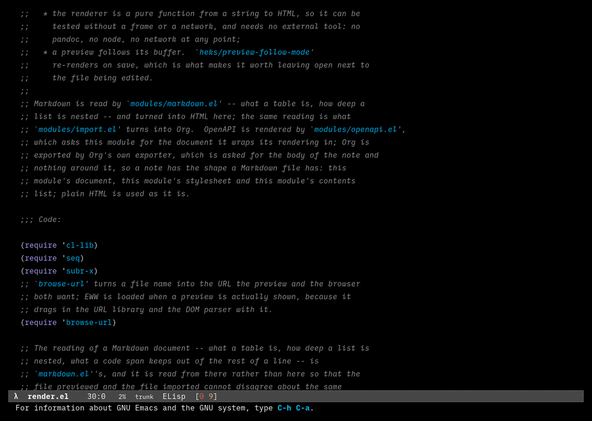
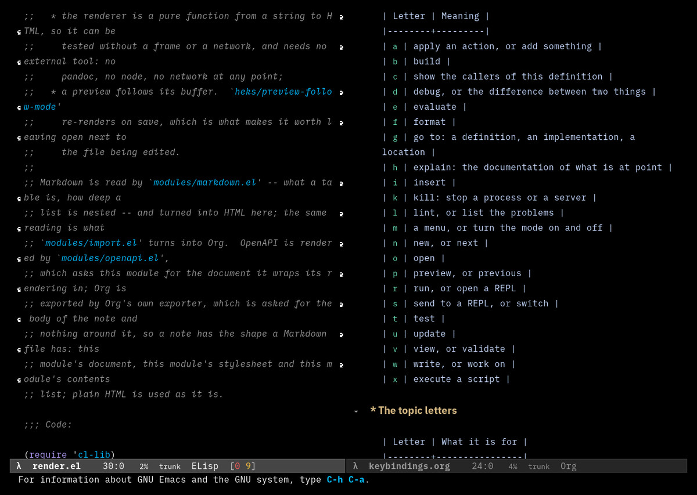
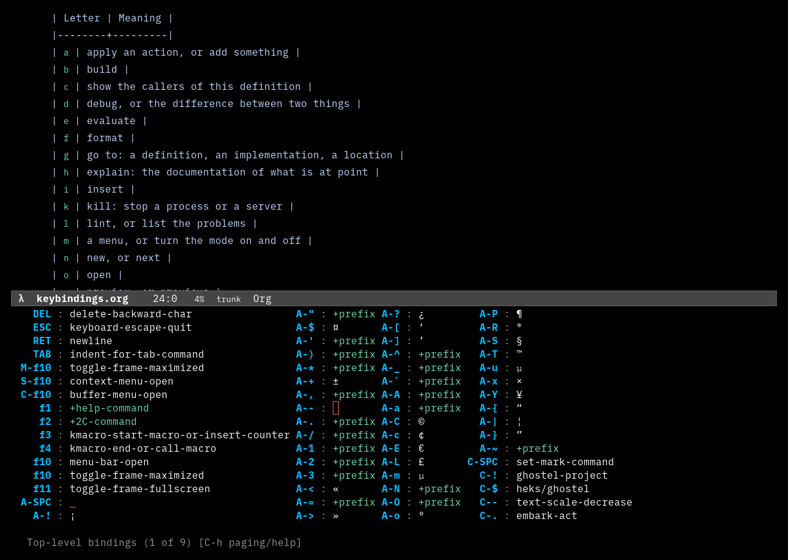

#+title: heks-emacs
#+subtitle: Emacs configuration of the warlock
#+author: Josep Bigorra
#+email: jjbigorra@gmail.com
#+options: toc:nil

[[https://jointhefreeworld.org/ggg/dist/gnu-emacs.svg]] [[https://jointhefreeworld.org/ggg/dist/maak.svg]] [[https://img.shields.io/badge/license-MIT-blue.svg]]

#+attr_html: :width 160 :alt heks-emacs logo

*Emacs configuration of the warlock*: a modular, delightful, reproducible Emacs
setup built with Emacs Lisp and [[https://github.com/progfolio/elpaca][Elpaca]], for GNU/Linux and macOS — many
languages, many palettes, one coherent place to work.

You could see heks-emacs as my temple to computing, almost an operating system
unto itself: a configuration that is not a list of packages with opinions glued
to it, but a place where notes, code, mail, music and the shell are the same
kind of thing, and where every part of it can be read and changed by the person
using it.

#+begin_quote
A tour of the configuration itself: the dashboard, an Org file folded to its
headlines, ~C-c~ explained by which-key while it is being typed, one of its own
modules, a Markdown note beside its rendering, an OpenAPI document read as a
specification, a shell script with its language server's hover documentation and
Flymake findings, the modules as files, five palettes over the same buffer, and
every text size from nano to jumbo. Every frame was recorded from a running
heks-emacs rather than drawn.
#+end_quote

[[https://jointhefreeworld.org/static-assets/heks/screen-2026-07-15-23-32-24.png]]

Two stills from the same GIF recording:
 and
.

** Five seconds on what this is

- *What it is* — a complete, modular Emacs configuration: not a package you
  install, a place you move into.
- *Who it is for* — people who want a working development environment on day
  one, and a configuration they can still read and change on day three hundred.
- *What makes it different* — every key lives under ~C-c~ with a grammar, every
  module owns one topic, and the documentation is generated from the code rather
  than written about it.
- *What it costs you* — one command, a couple of restarts while the packages
  resolve, and nothing else.
- *What it needs* — GNU/Linux or macOS and GNU Emacs (I run the ~master~ branch:
  32.0.50 at the time of writing).

** What you get

- *~C-c~ is a language, not a grab bag.* A letter for the topic, a letter for
  the action; ~f~ formats, ~t~ tests, ~g~ goes to a definition, and that meaning
  holds under every topic. ~which-key~ explains each key in the words of its
  topic while you are still learning it.
- *Notes, tasks, contacts and bookmarks as plain files.* One Org file per note,
  no database, generated index pages, an agenda, a graph, and an importer that
  turns the Markdown you already wrote into a note.
- *A development setup that goes deep:* Guile and Guix (with Geiser as the code
  intelligence, no language server needed), Common Lisp with SLY and SBCL,
  Scala, Haskell, Kotlin, Rust, Go, Python, Nix, JavaScript/TypeScript, shell,
  Terraform, SQL, and more — with Eglot, Flymake, Tree-sitter and formatters
  that agree with each other instead of reporting every line twice.
- *32+ palettes*, from Modus and the Ef collection to Catppuccin, Gruvbox,
  Kanagawa and Doom, with separators, faces and prose sizes derived from the
  theme so that nothing goes invisible when you switch.
- *An Eshell worth living in:* a prompt with user, host, path and Git branch,
  aliases for the things you actually type, and project shells opened next to
  the code they belong to.
- *The rest of a working day:* Gnus for mail and news, Circe for IRC, a map to
  look at, a fretboard to look up a chord on, and a pile of small commands that
  keep a five-second annoyance from being a five-second annoyance every day.
- *Read and present from Emacs:* ~C-c r p~ previews a Markdown file, an Org
  note, an OpenAPI specification or a plain text file as a themed HTML page with
  no network, and ~C-c r P~ turns the same document into a deck.
- *Reproducible by construction:* Elpaca manages the packages, ~maak~ runs the
  tasks, and the whole configuration is held to its own lint, key audit,
  renderer checks, ERT suite, golden pages and a batch verification.

** The numbers

| Measure                 | Value |
|-------------------------+-------|
| Packages                |  >140 |
| Functions               |  >500 |
| Interactive commands    |  >110 |
| Customization variables |   >50 |
| Unit tests              |  >180 |
| Themes                  |   >32 |
| Snippets                |  >200 |

#+begin_quote
Roughly, and growing every week.
#+end_quote

#+TOC: headlines 2

* Requirements and installation

GNU/Linux or macOS, GNU Emacs 29.1 or newer, git, and whatever the languages
you work in need. Nothing is installed by this file: the configuration is
cloned and ~maak install-emacs-config~ copies it into ~~/.emacs.d~, where
~src/init.el~ reads it and Elpaca installs the packages on the first start.

The requirements in full, both ways to install -- with
[[https://codeberg.org/jjba23/maak][Maak]], which is the recommended one, or by
hand -- the first start, a five-minute tour of what to press first, and what to
do when something is not right are in
[[file:docs/installation.org][docs/installation.org]].

* Configuration

The settings are read by a bridge -- ~heks-linux-bridge.el~ or
~cask-and-cons-bridge.el~ on those systems, or one of your own -- which is
loaded before the modules, because these are what the modules read while they
are set up. Every variable of the configuration, what each is for and its
default, and how a bridge is written, are in
[[file:docs/configuration.org][docs/configuration.org]]; the palettes, each with the mood it is for, are in
[[file:docs/themes.org][docs/themes.org]].

* Keybindings 🗝️

Everything this configuration adds lives under ~C-c~: a letter for the topic,
then a letter for the action. An action letter means the same thing under every
topic -- ~f~ formats, ~t~ tests, ~g~ goes to a definition, ~k~ stops a process,
~i~ inserts -- and a topic that keys something which is not an action (a font
size, *whose* configuration is being written, the journal entry for today) says
so in a table of its own rather than stretching the alphabet until it means
nothing.

** Learning a key while pressing it

~which-key~ shows the keys of a prefix while it is being typed, and it is taught
the whole key scheme here: every topic and every key is named in the words this
configuration gives it, so a key that is being learned is explained as it is
pressed rather than only in a document. Its menu is a window at the bottom of
the frame -- tall enough for the page it holds, with the number of the prefix's
keys it is showing in its mode line -- rather than the echo area, which cannot
grow past a quarter of the frame.

** The reference

The whole of it -- every topic, every key, and what both letters of it mean -- is
in [[file:docs/keybindings.org][the keybindings reference]]. That file is not written by hand: ~maak
keys-update~ writes it from the configuration, and ~maak keys~ fails while the
two disagree, so the document cannot say something the keys do not.

#+begin_src shell
maak keys         # the whole key tree, and every key that means two things
maak keys-update  # write docs/keybindings.org from the keys that are there
#+end_src

The rest of the tasks -- ~maak test~, ~maak golden~, ~maak verify~ and ~maak
check~ -- are in [[file:docs/development.org][docs/development.org]].

------------------------

* Modules

HEKS-EMACS is organized as a collection of focused modules. Each module owns a
particular aspect of the Emacs environment, keeping the configuration modular
and independently maintainable: the core and its bootstrap, the user interface
and its palettes, development (the languages, their language servers, sift,
Git, GitHub and onefetch), Org and knowledge management, the shell and the
system, search and navigation, mail, music and maps, writing and rendering,
the libraries, and AI.

Every module, in its own words -- what it does, how it is used, and why it is
written that way -- is in [[file:docs/modules.org][docs/modules.org]]. The source is the same reading
one file at a time: ~src/modules/~ is one topic per file, and every non-obvious
decision has the paragraph that explains *why* it was made beside it.

* AI

GPTel answers a prompt about what is at point, and ECA is the chat that reads
and edits the project. Both talk to either a personal DeepSeek account or
GitHub Copilot, and which one a session uses is not written into the checkout:
~auto~ takes the presence of the DeepSeek key as the sign that this is the
personal machine, ~HEKS_AI_PROVIDER~ (or ~heks/ai-provider~) names one
outright, and ~C-c x p~ moves the session to the other without a restart.

How the key is kept encrypted and given to both tools, and what ECA and GPTel
are told about the provider, are in [[file:docs/ai.org][docs/ai.org]].

------------------------

* Documents and further reading

The configuration is only half of it; the other half is written down:

| Document               | What is in it                                                                                                                                |
|------------------------+----------------------------------------------------------------------------------------------------------------------------------------------|
| [[file:docs/keybindings.org][docs/keybindings.org]]   | Every topic, every key, and what both letters of it mean -- generated from the configuration itself                                          |
| [[file:docs/notes.org][docs/notes.org]]         | The whole note-taking system: the philosophy, the layout, every file format, each workflow, index pages, syncing, setup, tweaking and an FAQ |
| [[file:docs/gnus.org][docs/gnus.org]]          | How mail and news are set up with Gnus in this configuration                                                                                 |
| [[file:docs/github-repo.org][docs/github-repo.org]]   | The GitHub repository settings as a spec, and the three commands that capture, apply and verify them                                         |
| [[file:NEWS.org][NEWS.org]]               | The changelog: what arrived, what changed and what was removed, per release                                                                  |
| [[file:docs/installation.org][docs/installation.org]]  | Requirements, the two ways to install, the first start, a five-minute tour and what to do when something is not right                        |
| [[file:docs/configuration.org][docs/configuration.org]] | Every customization variable, what it is for and its default, and how a bridge is written                                                    |
| [[file:docs/themes.org][docs/themes.org]]        | The palettes, each with the mood it is for                                                                                                   |
| [[file:docs/modules.org][docs/modules.org]]       | Every module, in its own words: what it does, how it is used, and why it is written that way                                                 |
| [[file:docs/onefetch.org][docs/onefetch.org]]      | The two onefetch screens: every repository in one buffer, and one repository in its own                                                      |
| [[file:docs/ai.org][docs/ai.org]]            | GPTel and ECA, the two accounts, and how the DeepSeek key is stored                                                                          |
| [[file:docs/development.org][docs/development.org]]   | The checks: what each Maak task does, and why the tests need nothing installed                                                               |

I recommend you browse the source code of heks-emacs and take inspiration from
it -- it is meant to be read, not just used. ~src/modules/~ is one topic per
file, and every non-obvious decision has the paragraph that explains *why* it
was made next to it.

* Development

The configuration is held to itself: the checks a contributor runs are the
ones CI runs, and they are all [[https://codeberg.org/jjba23/maak][Maak]] tasks --
~maak lint~, ~maak keys~, ~maak render~, ~maak test~, ~maak golden~,
~maak stats~ and ~maak verify~, with ~maak check~ running the lot.

What each task checks and why it exists, the golden pages, and why the tests
need nothing installed are in [[file:docs/development.org][docs/development.org]]. Run ~maak check~
before you send a patch.

* Contributing

Contributions are welcome, and this is the friendliest possible time to send
one: the modules are small, each one owns a single topic, and the checks tell
you when something does not fit.

- *Found a bug?* Open an issue on [[https://codeberg.org/jjba23/heks-emacs/issues][Codeberg]] with what you pressed, what you
  expected and what happened. Your Emacs version and the contents of
  ~*Messages*~ are usually the whole answer.
- *Have a fix?* Send a pull request on Codeberg, or a patch with ~git
  send-email~ if you prefer. Small commits, and a message that says why.
- *Have an idea?* Open an issue first if it is large; half the good ones here
  started as a conversation.
- *Documentation is code here.* The keybindings reference is generated, but
  the guides in ~docs/~ and this README are written by hand, and a correction
  is a real contribution.

Two house rules worth knowing before you write code:

1. *The module owns the topic.* A key about notes goes in ~notes.el~ and its
   table entry goes with it; a checker registers itself on its major mode and
   says nothing about language servers, so a server can neither lose a checker
   nor report a problem twice.
2. *A new key needs a new sentence.* Every key is described in the words of its
   topic, ~maak keys~ fails when it is not, and that failure exists so that no
   key arrives described only by a letter.

** AI policy

This project adheres to the [[https://jointhefreeworld.org/blog/articles/personal/jointhefreeworld-ai-policy/index.html][jointhefreeworld AI (Artificial Intelligence) policy]].

Our core principle is simple: *AI should assist human creativity and
problem-solving, never replace human reasoning.*

While tools like Large Language Models (LLMs) and interactive chatbots can be
beneficial for reviewing, refactoring small functions, or acting as a sounding
board, they should be used with moderation.

We require a human in the loop for all contributions.

** Code of conduct

This project adheres to the jointhefreeworld code of conduct. Find it here:

https://jointhefreeworld.org/blog/articles/personal/jointhefreeworld-code-of-conduct/index.html

In summary, we foster an inclusive, respectful, and cooperative environment for
all contributors and users of this free software project. Inspired by the ideals
of the GNU Project, we strive to uphold freedom, equality, and community as
guiding principles. We believe that collaboration in a community of mutual
respect is essential to creating excellent free software.

* License

heks-emacs, its source code and its documentation are licensed under the
*MIT License* (~MIT~). The full text is in [[file:LICENSE][LICENSE]].

In short: use it, read it, change it, share it.

* Supporting the project

If you like my work, please support me by [[https://bmc.link/jjbigorra][buying me a cup of coffee ☕]] so I can
continue with a lot of motivation. Stars, issues, patches and a screenshot of
your own heks-emacs are just as welcome.

-------
